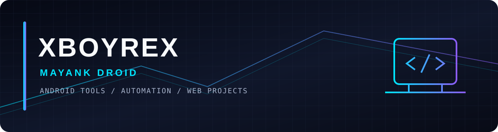

  
  
  

---

## `01 / ABOUT`

I build practical projects focused on Android utilities, ROM-flashing workflows, automation, and web experiences. I aim to make technical workflows clearer through useful features, straightforward interfaces, and maintainable implementations.

- **Name / brand:** Mayank Droid
- **GitHub:** [@xboyrex](https://github.com/xboyrex)
- **Main interests:** Android tools, ADB/Fastboot workflows, Python utilities, web development
- **Current focus:** ROM Flasher Pro and related developer tools

## `02 / FEATURED PROJECTS`

<table>
  <tr>
    <td width="50%" valign="top">
      <h3><a href="https://github.com/xboyrex/ROM-Flasher-Pro-by-Mayank-Droid">ROM Flasher Pro</a></h3>
      Android utility project for ROM-flashing workflows and related tools.
        
      
    </td>
    <td width="50%" valign="top">
      <h3><a href="https://mayank-droid.pages.dev">Mayank Droid</a></h3>
      Website and hub for tools, project updates, and related resources.
        
      
    </td>
  </tr>
  <tr>
    <td width="50%" valign="top">
      <h3><a href="https://onyx-services.pages.dev">Onyx Services</a></h3>
      Web-based service and utility project.
        
      
    </td>
    <td width="50%" valign="top">
      <h3><a href="https://mi-unlock.pages.dev">MI Unlock</a></h3>
      Web resource related to Xiaomi device-unlock workflows.
        
      
    </td>
  </tr>
</table>

## `03 / TECH STACK`

  
  
  
  

## `04 / WORKSTATION`

  

## `05 / GITHUB ANALYTICS`

  
  

  

## `06 / CONNECT`

  
  
  

GHOST PROTOCOL · BUILD · TEST · IMPROVE

